# 🛒 Retail Customer 360 Performance Dashboard

[](https://www.python.org/)
[](https://pandas.pydata.org/)
[](https://www.mysql.com/)
[](https://powerbi.microsoft.com/)
[](https://opensource.org/licenses/MIT)

An enterprise-grade, end-to-end **Retail Customer 360 Analytics & Performance Dashboard** pipeline. This project simulates, cleans, engineers, models, and visualizes retail customer behavior—generating deep insights into **RFM segmentation**, **Customer Lifetime Value (CLV)**, **category profitability**, and **sales velocity trends**.

---

## 📌 Architecture & Workflow

```mermaid
flowchart LR
    A["Raw Data Generator<br/>(Python)"] -->|"Synthetic Realistic Data"| B["MySQL / SQLite<br/>(retail_360)"]
    B -->|"SQL DDL & Queries"| C["ETL & Cleaning Engine<br/>(Pandas & NumPy)"]
    C -->|"Feature Engineering & RFM/CLV"| D["Analytics & Segmentation<br/>(High/Med/Low Value)"]
    D -->|"Export Formatted Datasets"| E["Power BI Ready Outputs<br/>(outputs/*.csv)"]
    E -->|"Star Schema & DAX"| F["Power BI Performance<br/>Dashboard"]
```



---

## 📁 Repository Structure

```
retail-customer-360/
├── data/
│   ├── raw/
│   │   ├── customers.csv           # Raw customer demographics
│   │   ├── products.csv            # Retail product catalog
│   │   └── orders.csv              # Transactional order records (1500+ records)
│   └── retail_360.db               # Embedded SQLite database for zero-setup execution
├── sql/
│   ├── 01_create_schema.sql        # MySQL DDL (PK, FK, Indexes, Constraints)
│   ├── 02_insert_data.sql          # SQL bulk data population script
│   └── 03_analytical_queries.sql   # Revenue, Top Customers, Category, Trends queries
├── scripts/
│   ├── config.py                   # Centralized configuration & thresholds
│   ├── generate_data.py            # Realistic dataset generator
│   ├── db_connector.py             # Dual MySQL / SQLite database manager
│   ├── data_processing.py          # Data cleaning, RFM, CLV, feature engineering
│   ├── export_dashboard_data.py    # Generates Power BI CSV outputs
│   └── run_pipeline.py             # Master orchestrator & executive insights printer
├── outputs/
│   ├── customers_cleaned.csv       # Cleaned customer profiles with totals
│   ├── sales_summary.csv           # Fact table: order-level sales, costs, margins
│   ├── customer_segments.csv       # RFM scores, personas, and CLV metrics
│   └── monthly_trends.csv          # Aggregated month-over-month trends
├── dashboard/
│   ├── POWER_BI_GUIDE.md           # Step-by-step visual creation & modeling manual
│   └── dax_measures.txt            # Ready-to-copy-paste DAX formulas
└── README.md                       # Complete project documentation
```

---

## 🛠️ Tech Stack

| Component | Technology | Purpose |
| :--- | :--- | :--- |
| **Language** | Python 3.10+ | Core ETL pipeline, analytics, automation |
| **Data Processing** | pandas, numpy | Cleaning, imputation, feature engineering, RFM scoring |
| **Databases** | MySQL 8.0+ / SQLite 3 | Relational modeling, schema constraints, indexing, analytics |
| **BI & Analytics** | Microsoft Power BI | Star schema modeling, DAX measures, interactive visuals |
| **Data Format** | CSV, SQL, DB | Interoperable tabular data storage |

---

## 🚀 Quickstart Guide

### 1. Prerequisites
Ensure you have **Python 3.10+** installed with `pandas` and `numpy`:
```bash
pip install pandas numpy
```
*(Optional for direct MySQL connection: `pip install pymysql` or `mysql-connector-python`)*

### 2. Run the Complete Pipeline (One-Click)
Run the master orchestrator to generate data, execute ETL, perform RFM/CLV segmentation, export Power BI CSVs, and display the executive report:

```bash
cd retail-customer-360
python scripts/run_pipeline.py
```

---

## 🗄️ MySQL Database Setup

If running against a live MySQL server:

1. **Log in to MySQL**:
   ```bash
   mysql -u root -p
   ```
2. **Execute Schema Creation**:
   ```sql
   SOURCE sql/01_create_schema.sql;
   ```
3. **Seed Database with 1500+ Records**:
   ```sql
   SOURCE sql/02_insert_data.sql;
   ```
4. **Execute Analytical Queries**:
   ```sql
   SOURCE sql/03_analytical_queries.sql;
   ```

*(Note: The Python pipeline features an automatic fallback to an embedded SQLite database so you can test all ETL and export steps even without a running MySQL instance!)*

---

## 🐍 Python Processing & Feature Engineering

The pipeline performs comprehensive data refinement:

### 1. Data Cleaning
- **Duplicate Removal**: Automatically removes duplicate transactional rows (`subset=['order_id']`).
- **Null Value Imputation**: Imputes missing customer ages using **median age** and fills missing locations with `'Unknown'`.
- **Type Enforcements**: Converts dates to `datetime64`, currency amounts to `float`, and IDs to `int`.

### 2. Feature Engineering
- `total_amount = quantity * price`
- `total_cost = quantity * cost`
- `profit = total_amount - total_cost`
- `profit_margin_pct = (profit / total_amount) * 100`
- `age_group` binned into: `18-25`, `26-35`, `36-45`, `46-55`, `56+`

### 3. Advanced Customer Analytics
- **RFM Analysis**:
  - **Recency (R)**: Days elapsed between customer's latest order and the dataset snapshot.
  - **Frequency (F)**: Total count of unique completed orders per customer.
  - **Monetary (M)**: Total lifetime expenditure by the customer.
  - **Quintile Scoring**: Quantile bins (1 to 5) assigned to each metric.
  - **Weighted RFM Score**: $0.20 \times R + 0.30 \times F + 0.50 \times M$.
- **Customer Segmentation**:
  - **High Value** (RFM $\ge 3.8$): Top spenders and frequent buyers.
  - **Medium Value** ($2.4 \le \text{RFM} < 3.8$): Consistent shoppers.
  - **Low Value** (RFM $< 2.4$): Infrequent, low spenders, or at-risk shoppers.
- **Customer Lifetime Value (CLV)**:
  $$\text{CLV} = \text{Average Order Value} \times \text{Annual Frequency} \times \text{Gross Margin \%} \times \text{3-Year Lifespan}$$

---

## 📊 Power BI Dashboard Blueprint

See [POWER_BI_GUIDE.md](file:///C:/Users/manoj/.gemini/antigravity/scratch/retail-customer-360/dashboard/POWER_BI_GUIDE.md) and [dax_measures.txt](file:///C:/Users/manoj/.gemini/antigravity/scratch/retail-customer-360/dashboard/dax_measures.txt) for full visual configuration and DAX formulas.

### 1. Star Schema Model
- **Fact Table**: `sales_summary` (contains order-level revenue, costs, quantities, timestamps).
- **Dimension 1**: `customers_cleaned` (contains demographic profiles, total orders, total spend).
- **Dimension 2**: `customer_segments` (contains RFM scores, personas, CLV values).

### 2. Core Visuals
1. **Header KPI Cards**:
   - Total Revenue (`$180,134.55`)
   - Total Gross Profit (`$108,190.55`)
   - Gross Margin (`60.06%`)
   - Total Customers (`283`)
   - Average Order Value (`$120.09`)
2. **Sales Trend (Line & Clustered Column Chart)**: Monthly revenue and monthly gross profit trend across quarters.
3. **Revenue by Category (Horizontal Bar Chart)**: Product category sales sorted descending with profit margin tooltip.
4. **Customer Segmentation (Donut Chart)**: Revenue share by High, Medium, and Low-Value tiers.
5. **Top 10 Customers (Matrix / Table)**: Customer name, city, orders count, total spend, and segment badge.
6. **Interactive Slicers**: Date range slider, product category dropdown, customer city/location filter, and age demographic tiles.

---

## 💡 10 Key Strategic Business Insights

Directly derived from the processed retail dataset:

1. **Pareto Revenue Concentration (72.6% Share)**:
   High-Value customers represent only **34.6% of all shoppers (98 customers)** but generate **72.60% ($130,784.28)** of total gross revenue. Preserving and nurturing this segment is the company's highest priority.
2. **Electronics Leads Revenue Volume**:
   **Electronics** is the company's largest top-line revenue driver at **$51,381.33 (28.5% of total sales)** with an average selling price of $109.99, led by smartwatches and noise-canceling headphones.
3. **Fashion Delivers Highest Profitability (63.3% Margin)**:
   While Electronics leads in gross volume, **Fashion boasts the highest gross profit margin at 63.3%**, yielding **$19,609.70 in gross profit** due to high product markups on items like denim jeans and windbreakers.
4. **Strong Repeat Customer Retention (83.8%)**:
   **83.75% of shoppers (237 customers) have placed repeat orders (2+ transactions)**, indicating high customer satisfaction and product-market fit.
5. **Prime Demographic Engine (Age 26–35)**:
   The **26–35 age cohort represents the largest consumer segment**, accounting for **$64,858.12 (36.01% of total revenue)** across 517 orders.
6. **Customer Lifetime Value (CLV) Multiplier**:
   High-Value customers hold an average projected 3-year CLV of **$2,397.04**—nearly **9x the CLV of Low-Value customers ($268.39)**.
7. **Top Geographic Markets**:
   **Hyderabad ($18,136.63)** and **Chicago ($18,129.20)** represent the top revenue-generating metropolitan areas, followed closely by Bengaluru ($15,131.33).
8. **Q4 Holiday Sales Spike**:
   Sales velocity peaked dramatically in **December 2024 ($18,628.79 across 137 orders)**, showing strong seasonal gifting demand in Home & Kitchen and Electronics.
9. **Champions Loyalty Cohort**:
   **70 customers qualify as 'Champions' (RFM 444+)**, maintaining purchase recency under 30 days and frequent multi-unit basket sizes.
10. **AOV Expansion Opportunity ($120.09)**:
   Average Order Value currently stands at **$120.09**. Implementing cross-sell product bundles (e.g. power banks + headphones or fitness accessories + jump ropes) provides a clear growth path to increase AOV past $140.

---

## 📄 License
This project is open-source and available under the [MIT License](LICENSE).
# retail-customer

# retail-customer

# retail-customer

# retail-customer

# retail-customer

# retail-customer

