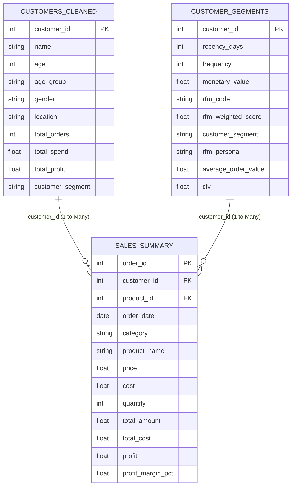

# Power BI Dashboard Implementation Guide: Retail Customer 360

This guide provides step-by-step instructions to build the **Retail Customer 360 Performance Dashboard** in Power BI Desktop using the processed datasets in the `outputs/` folder.

---

## 1. Data Ingestion (Power Query)

1. Open **Power BI Desktop**.
2. Click **Get Data** -> **Text/CSV**.
3. Load the following 4 files from the `outputs/` directory:
   - `customers_cleaned.csv`
   - `sales_summary.csv`
   - `customer_segments.csv`
   - `monthly_trends.csv`
4. In Power Query, verify data types:
   - `order_date`: **Date**
   - `customer_id`, `product_id`, `order_id`: **Whole Number**
   - `price`, `cost`, `total_amount`, `profit`, `clv`, `monetary_value`: **Fixed Decimal Number / Currency**
   - `profit_margin_pct`: **Percentage**
5. Click **Close & Apply**.

---

## 2. Data Modeling & Star Schema

Navigate to the **Model View** in Power BI Desktop and configure relationships:



### Relationship Settings:
1. `customers_cleaned[customer_id]` -> `sales_summary[customer_id]`:
   - Cardinality: **One to many (1:*)**
   - Cross filter direction: **Single**
2. `customer_segments[customer_id]` -> `sales_summary[customer_id]`:
   - Cardinality: **One to many (1:*)**
   - Cross filter direction: **Single**

---

## 3. Creating DAX Measures

In the **Report View**, click **New Measure** and add the core formulas (from `dashboard/dax_measures.txt`):

```dax
Total Revenue = SUM(sales_summary[total_amount])
Total Cost = SUM(sales_summary[total_cost])
Total Profit = [Total Revenue] - [Total Cost]
Profit Margin % = DIVIDE([Total Profit], [Total Revenue], 0)
Total Customers = DISTINCTCOUNT(customers_cleaned[customer_id])
Average Order Value = DIVIDE([Total Revenue], DISTINCTCOUNT(sales_summary[order_id]), 0)
Repeat Customer Rate % = 
    DIVIDE(
        CALCULATE(
            DISTINCTCOUNT(sales_summary[customer_id]),
            FILTER(VALUES(sales_summary[customer_id]), CALCULATE(DISTINCTCOUNT(sales_summary[order_id])) > 1)
        ),
        [Total Customers],
        0
    )
```

---

## 4. Dashboard Canvas Layout & Visual Architecture

### Canvas Setup:
- Page size: **16:9 (1920 x 1080 px)**
- Background: **Light neutral (`#F4F6F9`)** or Dark Mode (`#1E222D`)
- Font Family: **Segoe UI** / **Segoe UI Semibold**

### Visual Wireframe:

```
+---------------------------------------------------------------------------------------------------------+
| [LOGO]  RETAIL CUSTOMER 360 PERFORMANCE DASHBOARD                      [Date Slicer] [City] [Category]  |
+--------------------+--------------------+--------------------+--------------------+---------------------+
|   TOTAL REVENUE    |    GROSS PROFIT    |   PROFIT MARGIN    |  TOTAL CUSTOMERS   |  AVG ORDER VALUE    |
|    $180,134.55     |    $108,190.55     |       60.06%       |        283         |       $120.09       |
+--------------------+--------------------+--------------------+--------------------+---------------------+
|                                                  |                                                      |
|   MONTHLY SALES & PROFIT TREND (Line & Clustered)|   REVENUE & MARGIN BY PRODUCT CATEGORY (Bar Chart)   |
|   - X-Axis: order_year_month                     |   - Y-Axis: category                                 |
|   - Column Y-Axis: Total Revenue                 |   - X-Axis: Total Revenue                            |
|   - Line Y-Axis: Total Profit                    |   - Tooltip: Profit Margin %, Total Units Sold       |
|                                                  |                                                      |
+--------------------------------------------------+------------------------------------------------------+
|                                                  |                                                      |
|   CUSTOMER VALUE SEGMENTS (Donut Chart)          |   TOP 10 CUSTOMERS BY REVENUE (Table/Matrix)         |
|   - Legend: customer_segment                     |   - Columns: Rank, Name, Location, Orders,           |
|   - Values: Total Revenue / Customer Count       |              Total Spend, Profit, Segment            |
|   - Segments: High Value, Medium Value, Low Value|   - Sort: Total Spend DESC                           |
|                                                  |                                                      |
+--------------------------------------------------+------------------------------------------------------+
```

---

## 5. Visual Configuration Details

### Slicers (Top Filter Bar):
1. **Date Slicer**: `sales_summary[order_date]` (Between / Slider style).
2. **Category Filter**: `sales_summary[category]` (Dropdown style).
3. **Location Filter**: `customers_cleaned[location]` (Dropdown style with search).
4. **Age Group Filter**: `customers_cleaned[age_group]` (Tile / horizontal button style).

### KPI Cards (Top Metrics Bar):
- **Card 1 (Total Revenue)**: Value = `[Total Revenue]`, Display units = `$ Auto`, Data label size = 26pt bold.
- **Card 2 (Gross Profit)**: Value = `[Total Profit]`, Display units = `$ Auto`, Color = Emerald Green (`#10B981`).
- **Card 3 (Profit Margin)**: Value = `[Profit Margin %]`, Format = `0.00%`.
- **Card 4 (Total Customers)**: Value = `[Total Customers]`, Format = `#,##0`.
- **Card 5 (Average Order Value)**: Value = `[Average Order Value]`, Format = `$#,##0.00`.

### Chart 1: Sales Trend (Line & Clustered Column Chart)
- **Shared X-Axis**: `sales_summary[order_year_month]`
- **Column Values (Bars)**: `[Total Revenue]` (Navy Blue `#1E3A8A`)
- **Line Values**: `[Total Profit]` (Teal `#06B6D4`)
- **Features**: Data labels enabled on line; smooth line interpolation.

### Chart 2: Revenue by Product Category (Clustered Bar Chart)
- **Y-Axis**: `sales_summary[category]`
- **X-Axis**: `[Total Revenue]`
- **Data Colors**: Gradient based on `[Total Profit]` or category theme.
- **Data Labels**: Position = Outside end, Display units = `$ Auto`.

### Chart 3: Customer Value Segmentation (Donut Chart)
- **Legend**: `customer_segments[customer_segment]`
- **Values**: `[Total Revenue]`
- **Detail Labels**: Category + Percent of total (`High Value 72.6%`, `Medium Value 18.9%`, `Low Value 8.5%`).
- **Colors**:
  - High Value: Deep Navy (`#1D4ED8`)
  - Medium Value: Amber (`#F59E0B`)
  - Low Value: Slate Gray (`#94A3B8`)

### Chart 4: Top 10 Customers (Table / Grid)
- **Fields**:
  - `customers_cleaned[name]` (Customer Name)
  - `customers_cleaned[location]` (City)
  - `customers_cleaned[total_orders]` (Orders)
  - `customers_cleaned[total_spend]` (Total Spend - Currency format)
  - `customer_segments[clv]` (Projected CLV)
  - `customer_segments[customer_segment]` (Segment Badge)
- **Visual Level Filter**: Filter on `customers_cleaned[total_spend]`, Show Top 10.
- **Formatting**: Conditional background color data bars on `total_spend`.
